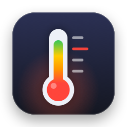
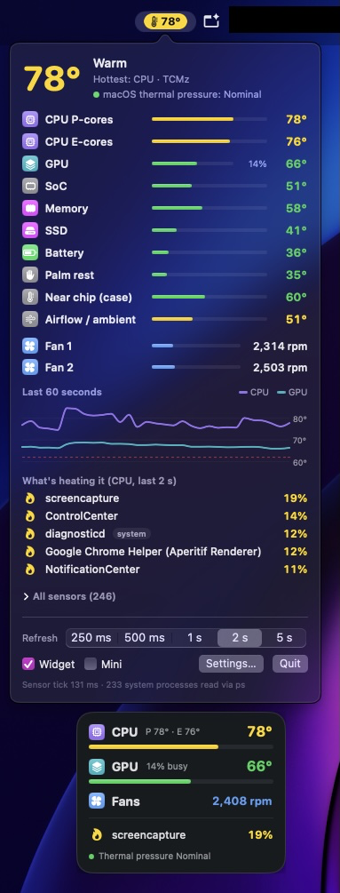
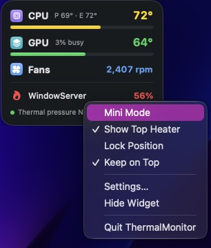
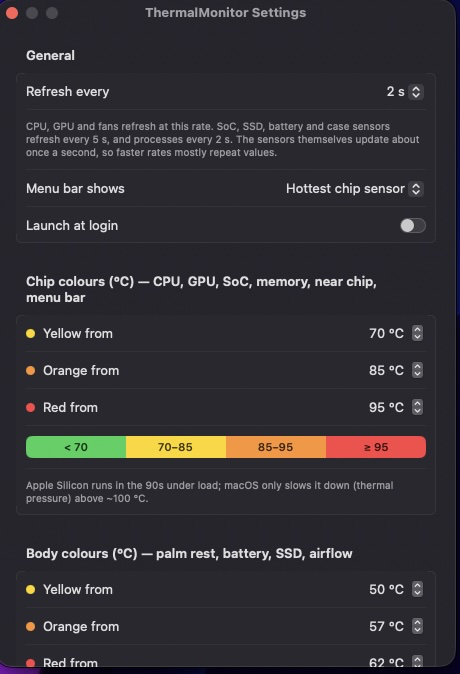
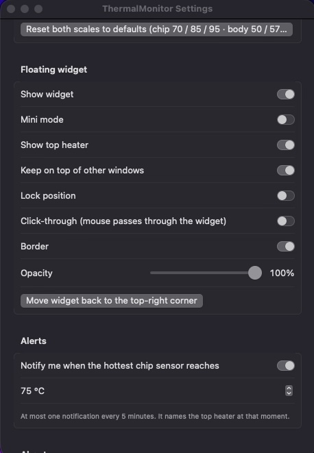

<p align="center">
  
</p>

<h1 align="center">ThermalMonitor</h1>

<p align="center">
  <b>See what is heating your Mac, live.</b><br>
  A native menu bar temperature monitor for Apple Silicon Macs, with a draggable floating widget.
</p>

<p align="center">
  
  
  
  
</p>

<p align="center">
  
</p>

## Features

- **Menu bar reading.** The hottest chip sensor, CPU or GPU, as a coloured pill that stays readable on any wallpaper.
- **Dropdown with the full picture.** CPU performance and efficiency cores, GPU, SoC, memory, SSD, battery, palm rest, airflow and Wi-Fi, each with its own bar. Fan speeds, a 60-second CPU/GPU chart, and every raw sensor on demand.
- **What's heating it.** The top processes by CPU over the last 2 seconds, including system processes (`WindowServer`, `diagnosticd`, …).
- **Floating widget.** Always on top, on every Space and over full-screen apps. Drag it anywhere and it remembers where you put it. Mini mode, click-through, opacity, border, lock position.
- **Two colour scales.** Chips and the Mac's body run very differently: a CPU at 90 °C under load is normal, a palm rest at 62 °C is not. Both scales are adjustable.
- **macOS' own verdict.** Shows thermal pressure (Nominal / Fair / Serious / Critical), so you can tell "hot" from "macOS is slowing things down".
- **Alerts.** Optional notification when the hottest chip sensor reaches your limit (at most one every 5 minutes), naming the top heater at that moment.
- **Light on resources.** About 3–4 % of one core at a 1 s refresh. Refresh from 250 ms to 5 s.

<p align="center">
  
</p>

## Install

1. Download the latest `ThermalMonitor-<version>.dmg` from [**Releases**](https://github.com/dan-robotics/thermal-monitor/releases/latest).
2. Optional: check it against `SHA256SUMS.txt` from the same release:
   ```bash
   shasum -a 256 ThermalMonitor-*.dmg
   ```
3. Open the DMG and drag **ThermalMonitor** onto **Applications**.
4. First launch: the app is ad-hoc signed, not notarized, so macOS blocks it once. Open it, then go to
   **System Settings › Privacy & Security** and click **Open Anyway**.
   (Right-click → Open no longer bypasses this on macOS 15 and later.)

"Launch at login" works best once the app is in `/Applications`.

Prefer not to run a downloaded binary? [Build it yourself](#build-from-source). It only takes a minute.

## Using it

- **Menu bar:** left-click opens the dropdown, right-click opens a short menu (widget, mini mode, settings, quit).
- **Widget:** drag it anywhere. Right-click for Mini Mode, Show Top Heater, Lock Position, Keep on Top, Settings, Hide, Quit.
- **Click-through on?** The widget then ignores the mouse. Turn it off from the menu bar's right-click menu.

<p align="center">
  
  
</p>

## Colours

Defaults, all adjustable in Settings:

| Scale | Used for | green | yellow | orange | red |
|---|---|---|---|---|---|
| **Chip** | CPU, GPU, SoC, memory, near chip, power, menu bar | < 70 | 70–85 | 85–95 | **≥ 95** |
| **Body** | palm rest, battery, SSD, airflow, Wi-Fi | < 50 | 50–57 | 57–62 | **≥ 62** |

Apple Silicon chips run in the 90s °C under load, and macOS only starts slowing them down above roughly 100 °C.
When a reading is hot, the header adds macOS' verdict: `· no slowdown`, `· near the limit` or `· macOS slowing down`.

## Privacy and security

- **Read-only.** It only reads sensors. It never writes to the SMC and never changes fan speeds.
- **No network.** It makes no connections at all: no telemetry, no update checks.
- **No root, no helper tools.** It runs as you, with no privileged helper and no sudo.
- **Stores only its settings** (UserDefaults, `io.github.dan-robotics.ThermalMonitor`).
- **One external program:** `/bin/ps`, called by full path with fixed arguments, to read CPU % of processes owned by other users (root daemons, `WindowServer`).
- **No third-party dependencies.** Apple frameworks only.

## What it reads

| Data | Source |
|---|---|
| CPU P-/E-cores (`Tp*`/`Te*`), CPU (`TC*`), GPU (`Tg*`), memory, case, ambient, fan RPM | AppleSMC keys (read commands only) |
| SoC die, SSD (NAND), battery | IOHID temperature sensors (`IOHIDEventSystemClient`) |
| Thermal pressure | `ProcessInfo.thermalState` |
| GPU busy % | IOAccelerator `PerformanceStatistics` |
| Heat suspects | `proc_pid_rusage` (CPU time + energy) for your processes, `/bin/ps` for other users' processes |

## Build from source

Needs the Xcode command line tools with Swift 6. Nothing else to install.

```bash
git clone https://github.com/dan-robotics/thermal-monitor.git
cd thermal-monitor
./build.sh                 # → dist/ThermalMonitor.app + dist/ThermalMonitor-<version>-<timestamp>.dmg
open dist/ThermalMonitor.app
```

`swift run ThermalMonitor` starts a quick dev build without an app bundle (notifications and launch at login need the bundle).

### Sensor test tool (no UI)

```bash
swift run thermal-probe                       # one full snapshot (takes ~2 s)
swift run thermal-probe --raw                 # + every raw sensor name and value
swift run thermal-probe --watch               # live line, 1 s refresh, Ctrl+C to stop
swift run thermal-probe --watch --interval 0.25
swift run thermal-probe --bench               # cost of each sensor source
swift run thermal-probe --help
```

## Compatibility

- **Tested on:** MacBook Pro M1 Pro, macOS 27.0.1.
- **Requires:** macOS 15 or later, Apple Silicon. Intel Macs are not supported.
- Sensor names and counts differ between chip generations and models. Other Apple Silicon Macs should work but are untested. Issues with `thermal-probe --raw` output are welcome.

## Known limitations

- The DMG is ad-hoc signed and not notarized (see [Install](#install)).
- The IOHID temperature API is exported by IOKit but not documented by Apple. A future macOS update could change it; the app then falls back to SMC sensors.
- A few SMC keys report implausible values on some models (for example ambient `Ta05`/`Ta06` around 8–11 °C on an M1 Pro).
- Watts per process come from the kernel's energy counters and only cover your own processes.

## Project layout

```
Package.swift
Sources/CSensors/            C: IOHID + AppleSMC readers
Sources/ThermalCore/         engine: models, sensors, process sampler, GPU
Sources/ThermalMonitorApp/   the app: Core/ (settings, store, alerts) + UI/ (menu bar, dropdown, widget, settings)
Sources/thermal-probe/       sensor test CLI
tools/make-icon.swift        draws the app icon
build.sh                     builds the .app + DMG
```

## License

[MIT](LICENSE) © 2026 Daniel Andries
